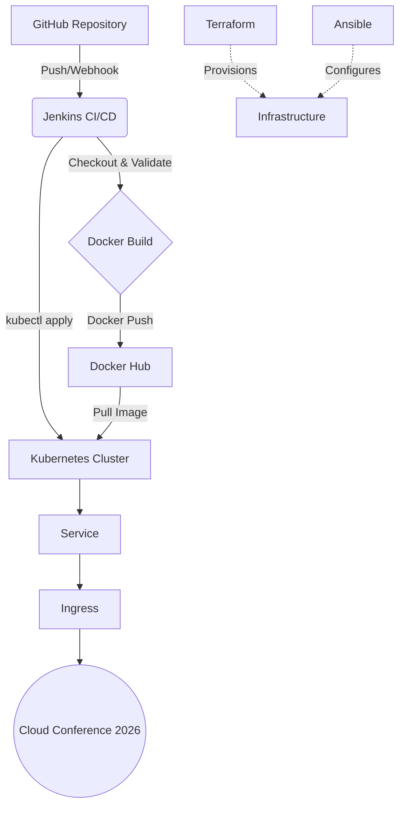

# Cloud Conference 2026

## Project Overview
This project is a complete, demo-ready DevOps implementation of a technology summit landing page. It showcases a modern web UI and a full end-to-end CI/CD workflow incorporating Git, Jenkins, Docker, Terraform, Ansible, and Kubernetes.

## Problem Statement
Beginners learning DevOps often struggle to understand how various tools piece together in a real-world pipeline. Creating an isolated component is easy, but integrating them into a cohesive lifecycle from source code to production Kubernetes deployment is challenging.

## Solution
This project provides a simple, structured, and fully integrated DevOps pipeline. It uses a lightweight static website, containers, infrastructure as code, configuration management, and container orchestration to demonstrate how modern applications are deployed at scale.

## Architecture



## Technology Stack
- **Frontend:** HTML5, CSS3, JavaScript
- **Web Server:** Nginx
- **Version Control:** Git & GitHub
- **CI/CD:** Jenkins
- **Containerization:** Docker & Docker Hub
- **Infrastructure as Code:** Terraform
- **Configuration Management:** Ansible
- **Container Orchestration:** Kubernetes (Docker Desktop)

## Project Structure
```
cloud-conference/
│
├── index.html               # Main HTML file
├── style.css                # CSS styles
├── script.js                # JS interactions
├── Dockerfile               # Docker image definition
├── .dockerignore            # Excluded files from Docker
├── .gitignore               # Excluded files from Git
├── Jenkinsfile              # Jenkins pipeline definition
├── README.md                # Project documentation
│
├── nginx/
│   └── nginx.conf           # Custom Nginx configuration
│
├── terraform/               # Infrastructure as code
│   ├── main.tf
│   ├── variables.tf
│   ├── outputs.tf
│   ├── providers.tf
│   └── terraform.tfvars.example
│
├── ansible/                 # Configuration management
│   ├── inventory.ini
│   ├── playbook.yml
│   └── ansible.cfg
│
└── k8s/                     # Kubernetes manifests
    ├── namespace.yaml
    ├── deployment.yaml
    ├── service.yaml
    └── ingress.yaml
```

## Prerequisites
- Windows 10/11 or macOS/Linux environment
- Administrator/root privileges for installations

## Windows Installation

1. **Install Git:** 
   - Source: [Git for Windows](https://git-scm.com/download/win)
   - Verify: `git --version`

2. **Install VS Code:**
   - Source: [Visual Studio Code](https://code.visualstudio.com/)

3. **Install Docker Desktop:**
   - Source: [Docker Desktop](https://www.docker.com/products/docker-desktop/)
   - Verify: `docker --version` and `docker compose version`

4. **Enable WSL 2:**
   - Open PowerShell as Admin: `wsl --install`
   - Restart and ensure Docker Desktop is configured to use the WSL 2 backend.

5. **Enable Docker Desktop Kubernetes:**
   - Open Docker Desktop Settings -> Kubernetes -> "Enable Kubernetes".
   - Verify: `kubectl version --client`

6. **Install Terraform:**
   - Source: [Terraform Downloads](https://developer.hashicorp.com/terraform/downloads) (Download Windows binary, extract, and add to PATH)
   - Verify: `terraform --version`

7. **Install Java JDK (For Jenkins):**
   - Source: [Adoptium OpenJDK 17](https://adoptium.net/)
   - Verify: `java -version`

8. **Install Jenkins:**
   - Source: [Jenkins Windows Installer](https://www.jenkins.io/download/) or run via Docker.
   - Example to run via Docker: `docker run -p 8080:8080 -p 50000:50000 jenkins/jenkins:lts`

9. **Install Ansible:**
   - Ansible does not run natively on Windows. Run it inside WSL.
   - Open WSL terminal (Ubuntu): 
     ```bash
     sudo apt update
     sudo apt install ansible
     ```
   - Verify: `ansible --version`

## GitHub Setup
1. Initialize repository:
   ```bash
   git init
   git add .
   git commit -m "Initial Cloud Conference project"
   git branch -M main
   ```
2. Push to GitHub:
   ```bash
   git remote add origin <your-repo-url>
   git push -u origin main
   ```

## Docker Setup
1. Build the image:
   ```bash
   docker build -t cloud-conference:test .
   ```
2. Run the container locally:
   ```bash
   docker run -d -p 8080:80 --name cloud-conference-test cloud-conference:test
   ```
3. Visit `http://localhost:8080` to see the application.
4. Clean up:
   ```bash
   docker stop cloud-conference-test
   docker rm cloud-conference-test
   ```

## Docker Hub Setup
1. Create an account at [hub.docker.com](https://hub.docker.com/).
2. Login from terminal: `docker login` (Use username and password/access token).
3. Image naming convention for the pipeline: `<DOCKERHUB_USERNAME>/cloud-conference:latest`

## Jenkins Setup
1. Access Jenkins at `http://localhost:8080`.
2. Get the initial admin password (from console output if using Docker, or from `C:\ProgramData\Jenkins\.jenkins\secrets\initialAdminPassword`).
3. Install suggested plugins.
4. Create an Admin user.
5. Create Docker Hub Credentials:
   - Go to Manage Jenkins -> Credentials -> System -> Global credentials.
   - Add Credentials. Kind: Username with password.
   - ID: `dockerhub-credentials`. Enter your Docker Hub username and password.
6. Create a new Pipeline Job. Point it to your GitHub repository and specify `Jenkinsfile`.

### GitHub Webhook Configuration
- If Jenkins runs locally (`localhost`), GitHub cannot reach it. 
- **Demo alternative:** Trigger the Jenkins build manually by clicking "Build Now".
- **Real webhook:** Expose Jenkins via ngrok (`ngrok http 8080`), go to GitHub Repo -> Settings -> Webhooks, and add `http://<ngrok-url>/github-webhook/`.

## Terraform Setup
For this demo, Terraform uses a safe local provider.
```bash
cd terraform
terraform init
terraform validate
terraform plan
terraform apply
```
*(Never run `terraform destroy` without explicit confirmation).*

## Ansible Setup
Run Ansible inside WSL to simulate server configuration:
```bash
cd ansible
ansible-playbook -i inventory.ini playbook.yml
```

## Kubernetes Setup
1. Edit your Windows hosts file (Run Notepad as Administrator, open `C:\Windows\System32\drivers\etc\hosts`):
   ```
   127.0.0.1 cloud-conference.local
   ```
2. If Docker Desktop does not have an Ingress controller installed, install Nginx Ingress:
   ```bash
   kubectl apply -f https://raw.githubusercontent.com/kubernetes/ingress-nginx/controller-v1.8.2/deploy/static/provider/cloud/deploy.yaml
   ```

## CI/CD Pipeline & Deployment Commands
In Jenkins, the pipeline automates the deployment. To run it manually:

1. Replace `<DOCKERHUB_USERNAME>` in `k8s/deployment.yaml` with your actual username.
2. Apply manifests:
   ```bash
   kubectl apply -f k8s/namespace.yaml
   kubectl apply -f k8s/deployment.yaml
   kubectl apply -f k8s/service.yaml
   kubectl apply -f k8s/ingress.yaml
   ```
3. Verification:
   ```bash
   kubectl get namespaces
   kubectl get pods -n cloud-conference
   kubectl get deployments -n cloud-conference
   kubectl get services -n cloud-conference
   kubectl get ingress -n cloud-conference
   ```
4. Check rollout status:
   ```bash
   kubectl rollout status deployment/cloud-conference -n cloud-conference
   ```
5. View Application: Open `http://cloud-conference.local` in your browser.

## Testing & Self-Healing
- **Scale:** `kubectl scale deployment cloud-conference --replicas=3 -n cloud-conference`
- **Self-Healing Demo:** 
  Find a pod: `kubectl get pods -n cloud-conference`
  Delete it: `kubectl delete pod <pod-name> -n cloud-conference`
  Watch Kubernetes immediately recreate it: `kubectl get pods -n cloud-conference -w`

## Troubleshooting
- **Docker command not recognized:** Ensure Docker Desktop is running and added to Windows PATH.
- **kubectl not recognized:** Ensure Kubernetes is enabled in Docker Desktop settings.
- **Jenkins cannot execute Docker/kubectl:** If Jenkins runs in a Docker container, it needs access to the host's Docker socket and kubeconfig. Alternatively, run Jenkins natively on Windows or WSL.
- **ImagePullBackOff:** Check if the Docker image was successfully pushed to Docker Hub and if the name in `deployment.yaml` is correct.
- **CrashLoopBackOff:** Check pod logs: `kubectl logs <pod-name> -n cloud-conference`. Usually indicates an issue with the application starting (e.g., Nginx config error).
- **Ingress not working / Port already in use:** Port 80 might be used by IIS or another service on Windows. Stop IIS or change the ingress port. Ensure Nginx Ingress Controller is running.
- **Terraform provider errors:** Run `terraform init` to download required providers.
- **Ansible not found on Windows:** Use WSL (Windows Subsystem for Linux) to run Ansible commands.

## Final Summary for Faculty
"GitHub is used for source control.
Jenkins automates the CI/CD pipeline.
Docker packages the application.
Docker Hub stores the image.
Terraform provisions infrastructure.
Ansible configures servers.
Kubernetes deploys and manages containers.
Ingress exposes the application."
